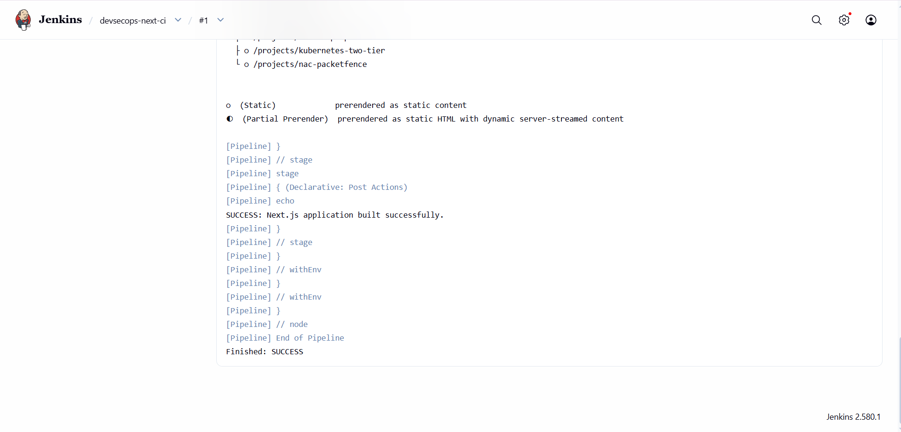

cd ~/devsecops-portfolio

cat > README.md <<'EOF'
# DevSecOps Portfolio

## I. Mise en place initiale

### 1. Installation Ubuntu Server 26.04 et SSH

```bash
sudo apt update
sudo apt install openssh-server -y
sudo systemctl enable --now ssh
sudo systemctl status ssh
hostname -I
```

### 2. Test SSH depuis la machine physique

```bash
ssh firas@IP_DE_LA_VM
```

### 3. Installation Docker

```bash
sudo apt update
sudo apt install docker.io -y
sudo systemctl enable --now docker
sudo systemctl status docker
docker --version
sudo docker run hello-world
```

### 4. Installation Jenkins

```bash
sudo apt update
sudo apt install fontconfig openjdk-21-jre -y
java -version
sudo systemctl enable --now jenkins
sudo systemctl status jenkins
sudo cat /var/lib/jenkins/secrets/initialAdminPassword
```

Accès Jenkins : `http://IP_DE_LA_VM:8080`

### 5. Création du mini-CV

```bash
mkdir -p ~/devsecops-portfolio
cd ~/devsecops-portfolio
touch index.html style.css script.js
git init
git add .
git commit -m "Create mini CV"
```

Lien GitHub : à compléter.

### 6. Configuration SSH avec GitHub

```bash
ssh-keygen -t ed25519 -C "firaskhdhir11@gmail.com"
cat ~/.ssh/id_ed25519.pub
ssh -T git@github.com
git remote -v
```

Résultat : authentification SSH réussie.

## II. Évolution vers DevSecOps Portfolio

### 7. Sections principales

- About
- Skills
- Projects
- Experience
- Contact

### 8. DevSecOps Skills

- Git
- Docker
- Jenkins
- Kubernetes
- Ansible
- Terraform
- Argo CD

### 9. Génération dynamique des projets

Fichier : `script.js`

```javascript
const projects = [
  {
    title: "DevSecOps Portfolio",
    description: "Portfolio HTML5, CSS3 et JavaScript."
  },
  {
    title: "Docker Deployment",
    description: "Déploiement du portfolio avec Docker et Nginx."
  },
  {
    title: "CI/CD Pipeline",
    description: "Automatisation avec Jenkins."
  }
];

const container = document.getElementById("projects-container");

if (container) {
  container.innerHTML = projects.map(project => `
    <article class="project">
      <h3>${project.title}</h3>
      <p>${project.description}</p>
    </article>
  `).join("");
}
```

## III. Dockerisation initiale

### 10. Dockerfile

Fichier : `Dockerfile`

```dockerfile
FROM nginx:alpine
COPY index.html /usr/share/nginx/html/index.html
COPY style.css /usr/share/nginx/html/style.css
COPY script.js /usr/share/nginx/html/script.js
EXPOSE 80
```

### 11. Construction de l'image Docker

```bash
docker build -t cv-docker .
docker images
```

### 12. Exécution du conteneur

```bash
docker run -d --name cv-container -p 8080:80 cv-docker
docker ps
```

Accès : `http://IP_DE_LA_VM:8080`

### 13. Déploiement Docker Compose

Fichier : `compose.yaml`

```yaml
services:
  portfolio:
    build: .
    image: cv-docker
    container_name: cv-compose
    ports:
      - "8080:80"
    restart: unless-stopped
```

Commandes :

```bash
docker compose up -d
docker compose ps
```

### 14. Publication sur GitHub via SSH

```bash
git status
git add .
git commit -m "Add Docker deployment"
git push origin main
```

## IV. Première introduction à l'automatisation

### 15. Installation de Vagrant

```bash
sudo apt update
sudo apt install vagrant virtualbox -y
vagrant --version
```

Fichier : `Vagrantfile`

```ruby
Vagrant.configure("2") do |config|
  config.vm.box = "ubuntu/noble64"
  config.vm.hostname = "devsecops-vm"
  config.vm.network "private_network", ip: "192.168.56.10"

  config.vm.provider "virtualbox" do |vb|
    vb.name = "DevSecOps-VM"
    vb.memory = 2048
    vb.cpus = 2
  end
end
```

### 16. Création de la VM et connexion

```bash
vagrant up
vagrant status
vagrant ssh
```

Comparaison :

- Création manuelle : configuration de la VM à travers l'interface graphique.
- Vagrant : création et configuration automatisées à partir d'un fichier.

### 17. Vérification de la configuration

```bash
vagrant status
vagrant ssh
hostname
ip addr
nproc
free -h
```

## Captures d'écran

Ajouter les captures d'écran réelles des étapes suivantes :

- Configuration SSH et connexion depuis la machine physique.
- Installation et vérification de Docker.
- Installation et accès à Jenkins.
- Mini-CV initial et DevSecOps Portfolio.
- Section DevSecOps Skills.
- Projets générés dynamiquement.
- Dockerfile et construction de l'image `cv-docker`.
- Résultat de `docker ps`.
- Résultat de `docker compose ps`.
- Publication GitHub via SSH.
- `vagrant up`, `vagrant ssh` et `vagrant status`.

## Conclusion

Ce projet met en pratique les outils fondamentaux du DevSecOps :
Git, SSH, Docker, Jenkins et Vagrant.
EOF

cat README.md
# devops


## IV. Première introduction à l'automatisation avec Vagrant

### 15. Installation et configuration

Vagrant version `2.4.9` a été installé sur la VM Ubuntu Server. VirtualBox a été utilisé comme provider.

Le fichier `Vagrantfile` permet de créer automatiquement une machine virtuelle Ubuntu :

```ruby
Vagrant.configure("2") do |config|
  config.vm.box = "bento/ubuntu-24.04"
  config.vm.hostname = "ubuntu-vagrant"
  config.vm.network "private_network", ip: "192.168.56.10"

  config.vm.provider "virtualbox" do |vb|
    vb.name = "Ubuntu-Vagrant"
    vb.memory = 1024
    vb.cpus = 1
  end
end
```

Validation et démarrage :

```bash
vagrant validate
vagrant up
```

### 16. Connexion SSH à la VM

La commande suivante permet de se connecter à la machine virtuelle créée par Vagrant :

```bash
vagrant ssh
```

Vérification de la configuration :

```bash
hostname
free -h
nproc
ip -4 addr
```

Résultats obtenus :
- Système : Ubuntu Server 24.04.3 LTS
- Hostname : `ubuntu-vagrant`
- Adresse IP privée : `192.168.56.10`
- Mémoire : environ 1 Go
- CPU : 1

### 17. Vérification de l'état de la VM

```bash
vagrant status
```

### Comparaison : création manuelle et Vagrant

La création manuelle nécessite une configuration à travers l'interface de l'hyperviseur. Vagrant automatise la création à partir d'un fichier `Vagrantfile` reproductible et facilite le démarrage, la connexion et la gestion de la machine virtuelle.


## VI. Jenkins CI Pipeline

### 22. Checkout du repository GitHub

Le pipeline Jenkins récupère automatiquement le code source depuis GitHub.

Repository : https://github.com/firaskhdhir11-lab/devops

Le fichier `Jenkinsfile` définit les étapes du pipeline.

### 23. Installation des dépendances

La commande suivante installe les dépendances du projet :

```bash
npm ci
```

Cette étape a été exécutée avec succès dans Jenkins.

### 24. Build de l'application Next.js

La commande suivante génère le build de production :

```bash
npm run build
```

Résultat : `Finished: SUCCESS`.

Les trois étapes du pipeline ont été exécutées avec succès :
Checkout GitHub, Install Dependencies et Build Next.js.


## Captures d'écran

### Jenkins CI Pipeline — Build réussi

Le pipeline Jenkins récupère le code depuis GitHub, installe les dépendances et construit l'application Next.js avec succès.




## VII. Automatisation avec Ansible

### 25. Installation d'Ansible

Ansible a été installé sur la machine d'administration. La commande suivante permet de vérifier sa version :

```bash
ansible --version
```

### 26. Configuration de l'inventaire

Le fichier `inventory` définit le serveur Ubuntu distant à administrer :

```ini
[servers]
ubuntu-server ansible_host=192.168.10.128 ansible_user=firas
```

Cette configuration permet à Ansible d'identifier le serveur cible et l'utilisateur SSH.

### 27. Vérification de la connexion distante

La connectivité avec le serveur a été vérifiée à l'aide du module `ping` :

```bash
ansible servers -i inventory -m ping --ask-pass
```

Le résultat `SUCCESS` avec `ping: pong` confirme que la communication entre Ansible et le serveur distant fonctionne.

### 28. Exécution des playbooks

#### Installation de curl

Le playbook `install-curl.yml` utilise le module `ansible.builtin.apt` pour assurer la présence du paquet `curl`.

```bash
ansible-playbook -i inventory install-curl.yml --ask-pass
```

L'exécution s'est terminée sans erreur (`failed=0`).

#### Vérification et démarrage de Docker

Le playbook `install-docker.yml` vérifie la version de Docker, démarre le service et active son démarrage automatique.

```bash
ansible-playbook -i inventory install-docker.yml --ask-pass
```

L'exécution s'est terminée sans erreur (`failed=0`).

**Remarque :** Docker était déjà installé sur le serveur. Le playbook vérifie son fonctionnement et démarre le service ; il ne réalise pas l'installation initiale.

### Captures d'écran

Les captures d'écran de cette activité sont disponibles dans le dossier [`activit 3 partie VII`](activit%203%20partie%20VII/).

Elles illustrent les vérifications et les opérations réalisées avec Ansible.

