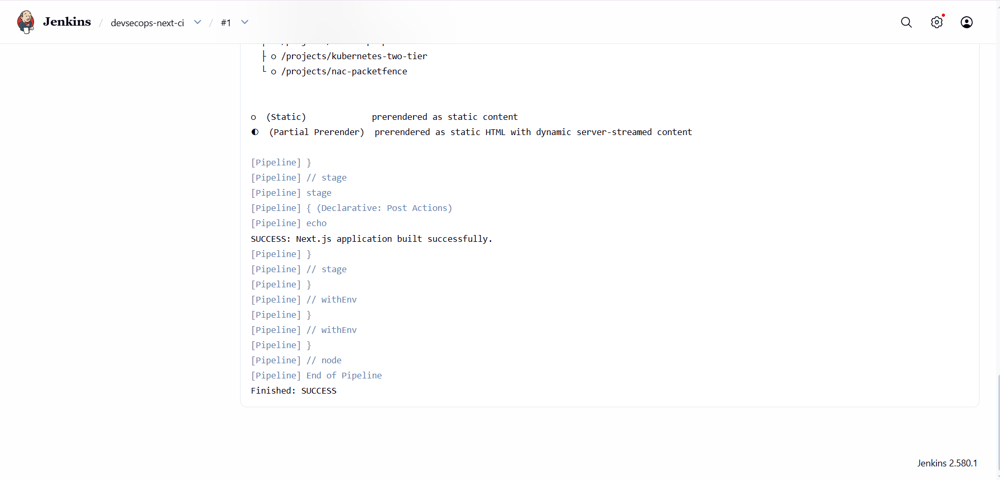
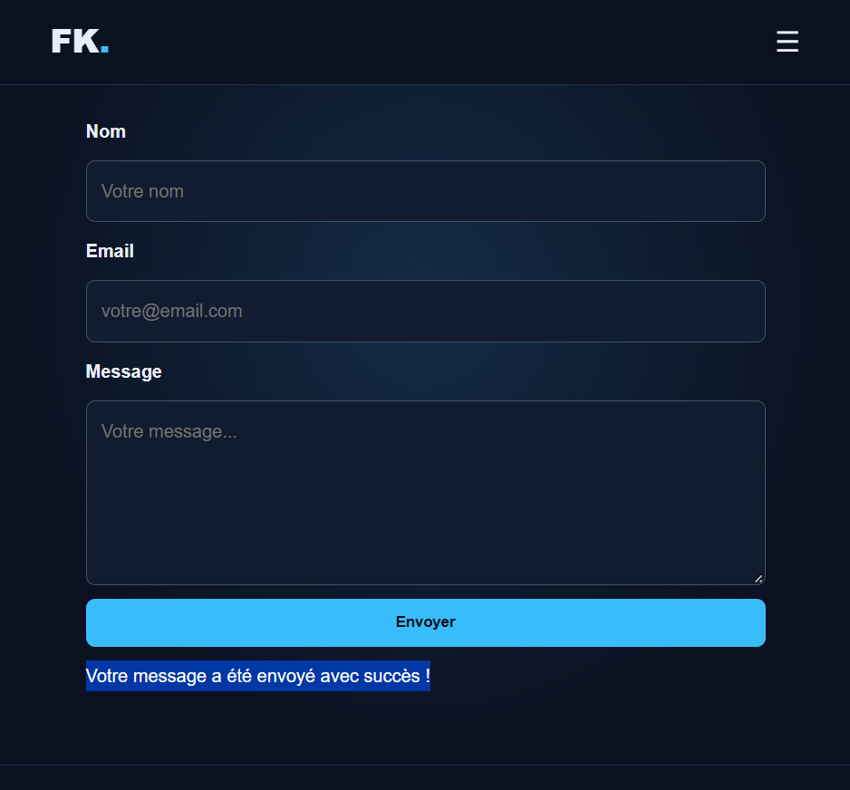

cd ~/devsecops-portfolio

cat > README.md <<'EOF'
# DevSecOps Portfolio

## I. Mise en place initiale

### 1. Installation Ubuntu Server 26.04 et SSH

```bash
sudo apt update
sudo apt install openssh-server -y
sudo systemctl enable --now ssh
sudo systemctl status ssh
hostname -I
```

### 2. Test SSH depuis la machine physique

```bash
ssh firas@IP_DE_LA_VM
```

### 3. Installation Docker

```bash
sudo apt update
sudo apt install docker.io -y
sudo systemctl enable --now docker
sudo systemctl status docker
docker --version
sudo docker run hello-world
```

### 4. Installation Jenkins

```bash
sudo apt update
sudo apt install fontconfig openjdk-21-jre -y
java -version
sudo systemctl enable --now jenkins
sudo systemctl status jenkins
sudo cat /var/lib/jenkins/secrets/initialAdminPassword
```

Accès Jenkins : `http://IP_DE_LA_VM:8080`

### 5. Création du mini-CV

```bash
mkdir -p ~/devsecops-portfolio
cd ~/devsecops-portfolio
touch index.html style.css script.js
git init
git add .
git commit -m "Create mini CV"
```

Lien GitHub : à compléter.

### 6. Configuration SSH avec GitHub

```bash
ssh-keygen -t ed25519 -C "firaskhdhir11@gmail.com"
cat ~/.ssh/id_ed25519.pub
ssh -T git@github.com
git remote -v
```

Résultat : authentification SSH réussie.

## II. Évolution vers DevSecOps Portfolio

### 7. Sections principales

- About
- Skills
- Projects
- Experience
- Contact

### 8. DevSecOps Skills

- Git
- Docker
- Jenkins
- Kubernetes
- Ansible
- Terraform
- Argo CD

### 9. Génération dynamique des projets

Fichier : `script.js`

```javascript
const projects = [
  {
    title: "DevSecOps Portfolio",
    description: "Portfolio HTML5, CSS3 et JavaScript."
  },
  {
    title: "Docker Deployment",
    description: "Déploiement du portfolio avec Docker et Nginx."
  },
  {
    title: "CI/CD Pipeline",
    description: "Automatisation avec Jenkins."
  }
];

const container = document.getElementById("projects-container");

if (container) {
  container.innerHTML = projects.map(project => `
    <article class="project">
      <h3>${project.title}</h3>
      <p>${project.description}</p>
    </article>
  `).join("");
}
```

## III. Dockerisation initiale

### 10. Dockerfile

Fichier : `Dockerfile`

```dockerfile
FROM nginx:alpine
COPY index.html /usr/share/nginx/html/index.html
COPY style.css /usr/share/nginx/html/style.css
COPY script.js /usr/share/nginx/html/script.js
EXPOSE 80
```

### 11. Construction de l'image Docker

```bash
docker build -t cv-docker .
docker images
```

### 12. Exécution du conteneur

```bash
docker run -d --name cv-container -p 8080:80 cv-docker
docker ps
```

Accès : `http://IP_DE_LA_VM:8080`

### 13. Déploiement Docker Compose

Fichier : `compose.yaml`

```yaml
services:
  portfolio:
    build: .
    image: cv-docker
    container_name: cv-compose
    ports:
      - "8080:80"
    restart: unless-stopped
```

Commandes :

```bash
docker compose up -d
docker compose ps
```

### 14. Publication sur GitHub via SSH

```bash
git status
git add .
git commit -m "Add Docker deployment"
git push origin main
```

## IV. Première introduction à l'automatisation

### 15. Installation de Vagrant

```bash
sudo apt update
sudo apt install vagrant virtualbox -y
vagrant --version
```

Fichier : `Vagrantfile`

```ruby
Vagrant.configure("2") do |config|
  config.vm.box = "ubuntu/noble64"
  config.vm.hostname = "devsecops-vm"
  config.vm.network "private_network", ip: "192.168.56.10"

  config.vm.provider "virtualbox" do |vb|
    vb.name = "DevSecOps-VM"
    vb.memory = 2048
    vb.cpus = 2
  end
end
```

### 16. Création de la VM et connexion

```bash
vagrant up
vagrant status
vagrant ssh
```

Comparaison :

- Création manuelle : configuration de la VM à travers l'interface graphique.
- Vagrant : création et configuration automatisées à partir d'un fichier.

### 17. Vérification de la configuration

```bash
vagrant status
vagrant ssh
hostname
ip addr
nproc
free -h
```

## Captures d'écran

Ajouter les captures d'écran réelles des étapes suivantes :

- Configuration SSH et connexion depuis la machine physique.
- Installation et vérification de Docker.
- Installation et accès à Jenkins.
- Mini-CV initial et DevSecOps Portfolio.
- Section DevSecOps Skills.
- Projets générés dynamiquement.
- Dockerfile et construction de l'image `cv-docker`.
- Résultat de `docker ps`.
- Résultat de `docker compose ps`.
- Publication GitHub via SSH.
- `vagrant up`, `vagrant ssh` et `vagrant status`.

## Conclusion

Ce projet met en pratique les outils fondamentaux du DevSecOps :
Git, SSH, Docker, Jenkins et Vagrant.
EOF

cat README.md
# devops


## IV. Première introduction à l'automatisation avec Vagrant

### 15. Installation et configuration

Vagrant version `2.4.9` a été installé sur la VM Ubuntu Server. VirtualBox a été utilisé comme provider.

Le fichier `Vagrantfile` permet de créer automatiquement une machine virtuelle Ubuntu :

```ruby
Vagrant.configure("2") do |config|
  config.vm.box = "bento/ubuntu-24.04"
  config.vm.hostname = "ubuntu-vagrant"
  config.vm.network "private_network", ip: "192.168.56.10"

  config.vm.provider "virtualbox" do |vb|
    vb.name = "Ubuntu-Vagrant"
    vb.memory = 1024
    vb.cpus = 1
  end
end
```

Validation et démarrage :

```bash
vagrant validate
vagrant up
```

### 16. Connexion SSH à la VM

La commande suivante permet de se connecter à la machine virtuelle créée par Vagrant :

```bash
vagrant ssh
```

Vérification de la configuration :

```bash
hostname
free -h
nproc
ip -4 addr
```

Résultats obtenus :
- Système : Ubuntu Server 24.04.3 LTS
- Hostname : `ubuntu-vagrant`
- Adresse IP privée : `192.168.56.10`
- Mémoire : environ 1 Go
- CPU : 1

### 17. Vérification de l'état de la VM

```bash
vagrant status
```

### Comparaison : création manuelle et Vagrant

La création manuelle nécessite une configuration à travers l'interface de l'hyperviseur. Vagrant automatise la création à partir d'un fichier `Vagrantfile` reproductible et facilite le démarrage, la connexion et la gestion de la machine virtuelle.


## VI. Jenkins CI Pipeline

### 22. Checkout du repository GitHub

Le pipeline Jenkins récupère automatiquement le code source depuis GitHub.

Repository : https://github.com/firaskhdhir11-lab/devops

Le fichier `Jenkinsfile` définit les étapes du pipeline.

### 23. Installation des dépendances

La commande suivante installe les dépendances du projet :

```bash
npm ci
```

Cette étape a été exécutée avec succès dans Jenkins.

### 24. Build de l'application Next.js

La commande suivante génère le build de production :

```bash
npm run build
```

Résultat : `Finished: SUCCESS`.

Les trois étapes du pipeline ont été exécutées avec succès :
Checkout GitHub, Install Dependencies et Build Next.js.


## Captures d'écran

### Jenkins CI Pipeline — Build réussi

Le pipeline Jenkins récupère le code depuis GitHub, installe les dépendances et construit l'application Next.js avec succès.




## VII. Automatisation avec Ansible

### 25. Installation d'Ansible

Ansible a été installé sur la machine d'administration. La commande suivante permet de vérifier sa version :

```bash
ansible --version
```

### 26. Configuration de l'inventaire

Le fichier `inventory` définit le serveur Ubuntu distant à administrer :

```ini
[servers]
ubuntu-server ansible_host=192.168.10.128 ansible_user=firas
```

Cette configuration permet à Ansible d'identifier le serveur cible et l'utilisateur SSH.

### 27. Vérification de la connexion distante

La connectivité avec le serveur a été vérifiée à l'aide du module `ping` :

```bash
ansible servers -i inventory -m ping --ask-pass
```

Le résultat `SUCCESS` avec `ping: pong` confirme que la communication entre Ansible et le serveur distant fonctionne.

### 28. Exécution des playbooks

#### Installation de curl

Le playbook `install-curl.yml` utilise le module `ansible.builtin.apt` pour assurer la présence du paquet `curl`.

```bash
ansible-playbook -i inventory install-curl.yml --ask-pass
```

L'exécution s'est terminée sans erreur (`failed=0`).

#### Vérification et démarrage de Docker

Le playbook `install-docker.yml` vérifie la version de Docker, démarre le service et active son démarrage automatique.

```bash
ansible-playbook -i inventory install-docker.yml --ask-pass
```

L'exécution s'est terminée sans erreur (`failed=0`).

**Remarque :** Docker était déjà installé sur le serveur. Le playbook vérifie son fonctionnement et démarre le service ; il ne réalise pas l'installation initiale.


### Captures d'écran

Les captures d'écran de cette activité sont disponibles dans le dossier [`activit 3 partie VII`](activit%203%20partie%20VII/).

Elles illustrent les vérifications et les opérations réalisées avec Ansible.


## VIII. Création de l'API Node.js / Express

### 29. Présentation
Une API REST a été développée avec Node.js et Express dans le dossier `api/`.

### 30. Endpoints disponibles
- `GET /api/health` : vérification de l'état de l'API.
- `GET /api/profile` : récupération du profil.
- `GET /api/projects` : récupération des projets.
- `GET /api/skills` : récupération des compétences.

### 31. Vérification de l'API
```bash
curl http://127.0.0.1:4005/api/health
curl http://127.0.0.1:4005/api/projects
curl http://127.0.0.1:4005/api/skills
```

### 32. Endpoint POST /api/contact

Un endpoint POST permet de recevoir les messages du formulaire de contact. Les champs obligatoires sont name, email et message.

- Test valide : HTTP 201 Created.
- Test avec le champ message manquant : HTTP 400 Bad Request.

L API vérifie la présence des trois champs avant d accepter le message.

### Captures d'écran
Les captures des tests de l'API et de son intégration au frontend sont disponibles dans le dossier `screenshots/api/`.

## IX. Conteneurisation avec Docker Compose

### 32. Construction et démarrage des services
```bash
docker compose up -d --build
```

### 33. Vérification des conteneurs
```bash
docker compose ps
docker compose logs
```

### 34. Accès à l'application
- Frontend : `http://192.168.10.128:3005`
- API : `http://192.168.10.128:4005`
- Vérification de l'API : `http://192.168.10.128:4005/api/health`
## 11. Automatisation avec Vagrant et Ansible

### 43. Déploiement automatique avec Ansible

Un playbook Ansible a été créé pour automatiser le déploiement du DevSecOps Portfolio avec Docker Compose.

Fichier utilisé : `ansible/deploy-portfolio.yml`

Commande d'exécution :

```bash
ansible-playbook ansible/deploy-portfolio.yml

### 45. Test de recréation automatique de la VM

Afin de vérifier l'automatisation complète, la machine virtuelle a été supprimée puis recréée à partir de zéro.

Commandes exécutées :

```bash
cd vagrant-ubuntu
vagrant destroy -f
vagrant up
### 33. Connexion du formulaire Next.js à l'API Express

Le formulaire de contact développé avec Next.js envoie les données (name, email et message) vers l'API Express via une requête HTTP POST sur `/api/contact`.

Après une réponse HTTP 201, un message de confirmation s'affiche et le formulaire est réinitialisé.

Capture d'écran du test réussi :


### Validation stricte avec Zod

La validation des données du formulaire de contact est assurée par la bibliothèque Zod.

Le schéma impose :
- Nom : entre 2 et 100 caractères.
- Email : format email valide.
- Message : entre 10 et 2000 caractères.
- Refus des propriétés supplémentaires.

**Test valide : HTTP 201 Created**

**Test avec un email invalide : HTTP 400 Bad Request**

Exemple de réponse :

```json
{
  "success": false,
  "error": "Validation failed",
  "details": [
    {
      "field": "email",
      "message": "Invalid email address"
    }
  ]
}
## Task 49 – Centralized Error Handling

A centralized error-handling middleware was added to the Express API.

Features:
- Catches errors using Express error middleware.
- Logs errors on the server.
- Returns the appropriate HTTP status code.
- Hides internal server details from API responses.
- Returns a consistent JSON error response.

Test:
```bash
curl -i -X POST http://localhost:4005/api/contact \
-H "Content-Type: application/json" \
-d '{bad json'
## Task 50 – HTTP Security Headers with Helmet

Helmet was installed and configured in the Express API to secure HTTP response headers.

Configuration:
- `app.use(helmet())`

Security headers verified:
- Content-Security-Policy
- X-Content-Type-Options: nosniff
- X-Frame-Options: SAMEORIGIN
- Strict-Transport-Security
- Referrer-Policy: no-referrer

Test:
```bash
curl -I http://localhost:4005/api/health
## Task 51 – API Rate Limiting

The `express-rate-limit` package was installed to protect the contact API against excessive requests.

Configuration:
- Protected endpoint: `POST /api/contact`
- Maximum requests: 5
- Time window: 15 minutes
- HTTP status after exceeding the limit: 429 Too Many Requests
- Standard rate-limit headers enabled.

Test:
Six consecutive POST requests were sent to the contact endpoint.

Results:
- Requests 1–5: HTTP 201 Created
- Request 6: HTTP 429 Too Many Requests

The test confirms that rate limiting is working correctly.
## Task 52 – OWASP API Security Top 10

The API was reviewed against the OWASP API Security Top 10 (2023).

| Risk | Identified Risk | Existing or Planned Mitigation |
|---|---|---|
| API1 - Broken Object Level Authorization | Limited: no user-owned resources currently exposed | Add object-level authorization if user accounts are introduced |
| API2 - Broken Authentication | Authentication is not currently implemented | Add JWT authentication when protected endpoints are introduced |
| API3 - Broken Object Property Level Authorization | Unauthorized or unexpected fields | Zod validation with strict schemas |
| API4 - Unrestricted Resource Consumption | Excessive contact requests | express-rate-limit: 5 requests per 15 minutes |
| API5 - Broken Function Level Authorization | No role-based access control currently | Implement RBAC for administrative endpoints |
| API6 - Unrestricted Access to Sensitive Business Flows | Automated contact submissions | Rate limiting on POST /api/contact |
| API7 - Server Side Request Forgery | No user-controlled external URL fetching | Validate destinations if external requests are introduced |
| API8 - Security Misconfiguration | Insecure HTTP configuration | Helmet security headers |
| API9 - Improper Inventory Management | API documentation and version inventory need improvement | Document endpoints and maintain API versions |
| API10 - Unsafe Consumption of APIs | No major third-party API integration currently | Validate and sanitize external API responses if integrations are introduced |

Reference:
https://owasp.org/API-Security/editions/2023/en/0x11-t10/

### 54. Stockage des messages Contact avec PostgreSQL

L API Express utilise PostgreSQL avec le package pg.

- Création de la table contacts.
- Validation des données avec Zod.
- Enregistrement avec une requête SQL paramétrée INSERT.
- Retour HTTP 201 après enregistrement.

Test : POST /api/contact avec curl.
Vérification : SELECT * FROM contacts;
Résultat : message enregistré avec succès dans PostgreSQL.

## Task 55 — Prisma Database Migrations

Prisma ORM is configured to manage PostgreSQL database migrations.

- Prisma version: 6.19.3
- Prisma Client: @prisma/client
- Database: PostgreSQL
- Model: Contact
- Migration directory: api/prisma/migrations

### Run database migrations

```bash
cd api
npm install
npx prisma generate
npm run db:migrate
```

### Verify migration status

```bash
npx prisma migrate status
```

The initial migration (0_init) was baselined against the existing PostgreSQL database without deleting existing contact records.

## Task 56 — Gestion des variables d'environnement

Les identifiants PostgreSQL sont externalisés dans des fichiers d'environnement.

- `.env.example` : variables utilisées par Docker Compose (`POSTGRES_DB`, `POSTGRES_USER`, `POSTGRES_PASSWORD`).
- `api/.env.example` : URL de connexion PostgreSQL utilisée par Prisma en local.
- `.env` : fichier local contenant les valeurs réelles, exclu de Git grâce à `.gitignore`.

### Configuration

```bash
cp .env.example .env
docker compose config
docker compose up -d --build

## 57. Automated Frontend Tests

Frontend tests are implemented using Vitest and React Testing Library.

Run the tests:

```bash
npm test
```

**Result:** 2 frontend tests passed successfully.

## 58. Automated Express API Tests

API tests are implemented using Vitest and Supertest.

Run the tests:

```bash
cd api
npm test
```

**Result:** 3 API tests passed successfully.

## 59. Automated API Security Tests

Security tests are implemented using Vitest and Supertest.

Run the API tests:

```bash
cd api
npm test
```

**Result:** 8 API security tests passed successfully, including input validation, malformed JSON and SQL injection protection.

## 60. Integration Tests — Frontend, API and PostgreSQL

An end-to-end integration test was performed to verify communication between the frontend, Express API and PostgreSQL database.

### Test procedure

1. Start all services:

```bash
docker compose up -d
```

2. Verify API health:

```bash
curl http://localhost:4005/api/health
```

3. Open the frontend at `http://192.168.10.128:3005` and submit a message using the Contact form.

4. Verify the database:

```bash
docker compose exec postgres psql -U devsecops -d devsecops -c "SELECT id, name, email, created_at FROM contacts ORDER BY id DESC LIMIT 10;"
```

**Result:** SUCCESS — The submitted contact message was stored successfully in PostgreSQL.

## 61. Automated Tests with Jenkins

The Jenkins pipeline automatically executes frontend and API tests and builds the Next.js application.

### Pipeline stages

- Install frontend dependencies.
- Run frontend tests.
- Install API dependencies.
- Run API tests.
- Build the Next.js application.

### Test results

- Frontend: 2 tests passed.
- API: 8 tests passed.
- Next.js production build: successful.

**Result:** SUCCESS — Jenkins completed all test and build stages.

## 62. Automated Docker Image Build with Jenkins

The Jenkins pipeline automatically builds Docker images for the frontend and API.

### Docker commands

```bash
docker build -t devsecops-portfolio:latest .
docker build -t devsecops-api:latest ./api
```

### Verification

```bash
docker images | grep devsecops
```

**Result:** SUCCESS — Jenkins successfully built both Docker images:

- `devsecops-portfolio:latest`
- `devsecops-api:latest`

## 63. Docker Image Tagging with Git SHA

The Jenkins pipeline automatically tags Docker images using the short Git commit SHA.

### Tagging strategy

Each image receives two tags:

- `latest`: identifies the most recent build.
- Git SHA: identifies the exact source code version.

### Verification

```bash
docker images --format "table {{.Repository}}\t{{.Tag}}\t{{.ID}}" | grep devsecops
```

**Result:** SUCCESS — Jenkins successfully created the `latest` and `dc7f0c7` tags for both Docker images. Both tags of each image reference the same image ID.
## 64. Secret Scanning with Gitleaks

Gitleaks scans the Git repository history to detect accidentally committed secrets and credentials.

### Jenkins pipeline

```groovy
stage('64 - Gitleaks Secret Scan') {
  steps {
    sh 'gitleaks detect --source . --redact --verbose'
  }
}


## 65. Static Application Security Testing (SAST) with Semgrep

Semgrep analyzes the frontend and backend source code to identify potential security issues.

### Jenkins pipeline

```groovy
stage('65 - Semgrep SAST') {
    steps {
        sh '''
            docker run --rm \
              -v "$WORKSPACE:/src:ro" \
              -w /src \
              semgrep/semgrep:latest \
              semgrep scan --config p/default --metrics=off .
        '''
    }
}

```

## 66. Node.js Dependency Audit with npm audit

The pipeline checks frontend and backend dependencies for known security vulnerabilities.

### Jenkins pipeline

```groovy
stage('66 - Node.js Dependency Audit') {
    steps {
        sh 'npm audit'
        dir('api') {
            sh 'npm audit'
        }
    }
}
```

### Verification

- Frontend dependencies audited successfully.
- Backend dependencies audited successfully.
- Both audits returned: `found 0 vulnerabilities`.

**Result:** SUCCESS — npm audit completed for both frontend and backend dependencies.

## 67. OWASP Dependency-Check – Software Composition Analysis (SCA)

OWASP Dependency-Check is integrated into the Jenkins pipeline to identify publicly disclosed vulnerabilities in project dependencies.

### Jenkins pipeline

```groovy
stage('67 - OWASP Dependency-Check') {
    steps {
        withCredentials([string(credentialsId: 'NVD_API_KEY', variable: 'NVD_API_KEY')]) {
            sh '''
                mkdir -p "$WORKSPACE/dependency-check-report"

                docker run --rm \
                    --user "$(id -u):$(id -g)" \
                    -v "$WORKSPACE:/src" \
                    -v "$JENKINS_HOME/.dependency-check-data:/usr/share/dependency-check/data" \
                    -v "$WORKSPACE/dependency-check-report:/report" \
                    owasp/dependency-check:latest \
                    --scan /src/package.json \
                    --scan /src/package-lock.json \
                    --scan /src/api/package.json \
                    --scan /src/api/package-lock.json \
                    --format HTML \
                    --out /report \
                    --nvdApiKey "$NVD_API_KEY"
            '''

            archiveArtifacts artifacts: 'dependency-check-report/dependency-check-report.html', fingerprint: true
        }
    }
}
```

### Verification

- NVD API Key configured securely in Jenkins Credentials.
- Dependency-Check analysis completed successfully.
- HTML vulnerability report generated and archived in Jenkins.
- Jenkins pipeline completed successfully.

**Result:** SUCCESS — OWASP Dependency-Check successfully analyzed the project dependencies and generated an HTML security report.

## 68. Docker Image Security Scanning with Trivy

Trivy scans both Docker images for critical vulnerabilities and embedded secrets.

### Jenkins pipeline

```groovy
stage('68 - Trivy Image Scan') {
    steps {
        sh 'trivy image --scanners vuln --pkg-types os,library --severity CRITICAL --exit-code 1 devsecops-portfolio:latest'
        sh 'trivy image --scanners vuln --pkg-types os,library --severity CRITICAL --exit-code 1 devsecops-api:latest'
        sh 'trivy image --scanners secret --exit-code 1 devsecops-portfolio:latest'
        sh 'trivy image --scanners secret --exit-code 1 devsecops-api:latest'
    }
}
```

### Verification

- Frontend Docker image scanned with Trivy.
- Backend Docker image scanned with Trivy.
- Critical vulnerabilities and secrets are configured to fail the pipeline.

**Result:** SUCCESS — Trivy security scanning is integrated into the Jenkins pipeline.

## 69. Security Gate – Fail the Pipeline on Critical Findings

The Jenkins pipeline enforces security checks and stops execution when a blocking security issue is detected.

### Security enforcement

- **Gitleaks:** the pipeline fails when secrets are detected.
- **Trivy vulnerability scan:** `--exit-code 1` makes the scan fail when critical vulnerabilities are found.
- **Trivy secret scan:** `--exit-code 1` makes the scan fail when secrets are detected.
- Jenkins stops subsequent stages when a stage fails.

### Verification

- Successful pipeline execution: demonstrates that the security checks passed.
- Intentionally failed pipeline execution: must be tested by introducing a controlled secret or critical finding in a safe test branch, then confirming that Jenkins fails at the relevant stage.

**Result:** Security gates are configured. The intentional failure test and its screenshot are still pending.


## 74 - CodeQL vs Semgrep

| Criterion | GitHub CodeQL | Semgrep |
|---|---|---|
| Type | Semantic SAST analysis | Pattern-based SAST analysis |
| Analysis | Builds a code database and runs queries | Matches code patterns and rules |
| Integration | Native GitHub Security integration | CLI, Docker and CI/CD integration |
| Findings | Code vulnerabilities and security paths | Security issues and insecure coding patterns |
| Pipeline | Dedicated GitHub Actions workflow | Integrated into CI workflow |
| Main advantage | Deep semantic analysis | Fast and flexible rule configuration |

**Conclusion:** CodeQL provides deep semantic analysis and native GitHub integration, while Semgrep offers fast and flexible static analysis. Using both improves security coverage through complementary detection approaches.

## 77 - Securing the CI/CD Pipeline

### Immutable GitHub Actions

Third-party GitHub Actions are pinned to full commit SHAs instead of mutable version tags. This prevents an action tag from silently changing to different code.

### Least Privilege

Workflows use minimum required GITHUB_TOKEN permissions:
- CI workflow: contents: read.
- CodeQL workflow: contents: read, security-events: write, actions: read.

### CI/CD as an Attack Surface

The CI/CD pipeline is part of the software supply chain. Attackers may target compromised third-party actions, stolen secrets, excessive token permissions, or malicious dependencies.

Security measures include:
- Pinning third-party actions to immutable commit SHAs.
- Restricting token permissions.
- Scanning secrets and dependencies.
- Running SAST and container image scans.
- Reviewing workflow changes through pull requests.


## 78 - GitHub Actions vs Jenkins

| Criterion | GitHub Actions | Jenkins |
|---|---|---|
| Hosting | GitHub-hosted runners or self-hosted runners | Self-hosted automation server |
| Configuration | YAML workflows in `.github/workflows/` | `Jenkinsfile` using Pipeline syntax |
| Git integration | Native integration with GitHub repositories and pull requests | Integrates with Git providers through plugins |
| Testing | Frontend and API tests | Frontend and API tests |
| Secrets scanning | Gitleaks | Gitleaks |
| SAST | Semgrep and CodeQL | Semgrep |
| Dependency security | npm audit | npm audit and OWASP Dependency-Check |
| Container security | Trivy | Trivy |
| Docker build | Builds frontend and API images | Builds frontend and API images |
| Maintenance | GitHub manages hosted runners | Administrator manages Jenkins server and plugins |
| Extensibility | GitHub Actions marketplace | Large Jenkins plugin ecosystem |

**Conclusion:** GitHub Actions provides native GitHub integration and managed runners, while Jenkins offers flexibility and extensive plugin support with greater infrastructure maintenance responsibility. Both pipelines implement testing, security scanning, and Docker image building.

## 79 - Git Workflow

The project follows a branch-based workflow:

1. Create a feature or fix branch from `main`.
2. Implement changes and commit them.
3. Push the branch to GitHub.
4. Open a Pull Request targeting `main`.
5. Review the changes and verify all required CI checks.
6. Merge the Pull Request after approval and successful checks.

### Branch Naming Convention

- `feature/<description>`: new features.
- `fix/<description>`: bug fixes.
- `docs/<description>`: documentation changes.
- `security/<description>`: security improvements.

**Rule:** Direct work on `main` should be avoided. Changes must be proposed through Pull Requests.
